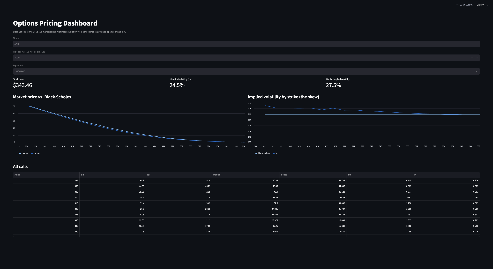

# Options Pricing Dashboard

A live options analytics dashboard that prices call options with the Black-Scholes model, compares the results to real market prices, and solves for implied volatility across strikes.



## What it does

- Pulls live stock prices and option chains for any ticker (via `yfinance`)
- Prices every call option with a from-scratch Black-Scholes implementation
- Estimates historical volatility from one year of daily log returns
- Solves for **implied volatility** for each strike using binary search
- Charts model vs. market prices and the **volatility skew** in an interactive Streamlit app

## How it works

**Pricing.** Black-Scholes takes five inputs (stock price, strike, time to expiry, interest rate, volatility) and returns a fair value for a call. Four inputs are observable. Volatility is not, so the model first uses historical volatility as an estimate.

**Implied volatility.** Black-Scholes price increases monotonically with volatility, so for any market price there is exactly one volatility that reproduces it. There is no closed-form inverse, so `implied_vol()` finds it with binary search over 1%–300%, converging to within $0.000001.

**Market vs. model.** The gap between the two shows what the market believes that history doesn't capture.

## Findings (Oct 2026 sample run)

- **The market priced AAPL calls above the historical-vol model.** Implied vol was ~28% vs. 24.5% historical, meaning the market expected more movement ahead (an earnings release fell before expiry).
- **Implied vol was not flat across strikes.** It ranged from ~33% at low strikes down to ~24% at high strikes. This is the volatility skew: markets pay extra for crash protection, which Black-Scholes's constant-volatility assumption ignores.
- **Riskier stocks carry higher implied vol.** TSLA's median implied vol was ~47% vs. ~28% for AAPL.

## Run it

```bash
python3 -m venv .venv
source .venv/bin/activate
pip install -r requirements.txt
streamlit run app.py
```

`main.py` prints the same analysis to the terminal. `python black_scholes.py` runs a textbook sanity check (expects `10.45`).

## Project structure

```
black_scholes.py   # pricing model, normal CDF, implied-vol solver
app.py             # Streamlit dashboard
main.py            # command-line version
```

## Limitations and next steps

- Uses bid/ask midpoints, so it can be noisy for illiquid strikes
- Assumes no dividends and European-style exercise (US equity options are American)
- Next: add puts, Greeks (delta, gamma, vega), and a 3D volatility surface across expirations